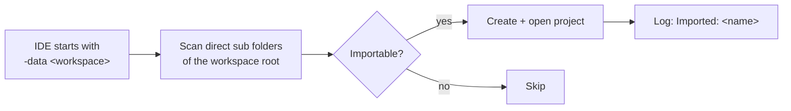

<div align="center">

# 4diac IDE Workspace Auto-Import

**Clone the training repo, start the IDE – all projects are already there.**

An Eclipse 4diac IDE plugin that automatically imports all projects found in the
workspace folder on startup. No more *File → Import → Existing Projects*.

[](https://github.com/Meisterschulen-am-Ostbahnhof-Munchen/4diac-ide-autoimport/actions/workflows/build.yml)
[](https://github.com/Meisterschulen-am-Ostbahnhof-Munchen/4diac-ide-autoimport/releases)
[](LICENSE)
[](https://eclipse.dev/4diac/)

</div>

---

## Why?

Training repositories ship a ready-made 4diac workspace folder, e.g.
`Ventilsteuerung/4diacIDE-workspace` with the projects `test_AX`, `test_B`, `test_VV`.
The Eclipse workspace metadata (`.metadata`) is – rightly – never committed. So after
cloning, the IDE shows an **empty workspace**, and every participant has to import the
projects by hand. In a classroom that can cost up to two hours.

| | Without plugin | With plugin |
|---|---|---|
| After cloning | *"There are no projects in your workspace."* | All projects visible in the System Explorer |
| Clicks per participant | Import wizard: browse, select, finish – per workspace | **none** |
| `.metadata` in Git needed? | – | **no**, it is created on first start |

## How it works



On every start, after the workbench is up, the plugin imports each **direct sub folder
of the workspace root** that

- ✅ contains a `.project` file,
- ✅ does **not** start with `.` – so `.lib` and `.metadata` are skipped,
- ✅ has a project name in `.project` equal to the folder name,
- ✅ is not yet part of the workspace.

Projects that are already in the workspace are left untouched, so it is safe on every
start. Each import is written to the workspace log `.metadata/.log`:

```
!ENTRY de.meisterschulen.fordiac.ide.autoimport 1 0 2026-11-08 17:46:35.222
!MESSAGE Imported: test_AX
```

## Installation

1. Download `de.meisterschulen.fordiac.ide.autoimport_<version>.jar` from the
   [latest release](https://github.com/Meisterschulen-am-Ostbahnhof-Munchen/4diac-ide-autoimport/releases).
2. Copy it into the `dropins` folder of the 4diac IDE (create the folder if missing):

   ```
   4diac-ide/
   ├── 4diac-ide.exe
   ├── dropins/
   │   └── de.meisterschulen.fordiac.ide.autoimport_1.0.0.jar
   └── plugins/
   ```

3. Start the IDE with the workspace folder of the repository:

   ```bat
   4diac-ide.exe -data "C:\path\to\repo\Ventilsteuerung\4diacIDE-workspace"
   ```

No admin rights needed. To uninstall, delete the jar.

> [!TIP]
> Each release also contains a `.sha256` file – check it before rolling the jar out to
> many machines.

## Compatibility

| 4diac IDE | Platform | Status |
|---|---|---|
| 3.4.0 Milestone 2026-11-05_2214 | Windows x86_64 | ✅ tested with `4diac_training1` (3 projects imported on first start) |

The plugin only uses long-stable Eclipse platform API (`org.eclipse.ui.startup`,
`org.eclipse.core.resources`), so other 4diac IDE versions should work as well.

## Building

Requires a **JDK ≥ 21** and **bash** (Git Bash on Windows works).

```bash
bash build.sh                                  # downloads the pinned 4diac IDE ZIP once into build/
IDE_ZIP=/path/to/4diac-ide.zip bash build.sh   # or use a local copy
```

The plugin is compiled against the plugins of the 4diac IDE milestone pinned in
[`build.sh`](build.sh) (SHA256-checked). Output: `dist/*.jar` and `dist/*.jar.sha256`.

## Releasing

1. Raise `Bundle-Version` in [`META-INF/MANIFEST.MF`](META-INF/MANIFEST.MF).
2. Commit, then tag `v<version>` – it must equal `Bundle-Version` – and push the tag.
3. GitHub Actions builds the jar and publishes the release with jar and `.sha256`.

## Related

- [TrainingsInstaller](https://github.com/Meisterschulen-am-Ostbahnhof-Munchen/TrainingsInstaller) –
  installs Git, Python, the 4diac IDE (with this plugin) and the training repos on
  participant notebooks.
- [Eclipse 4diac](https://eclipse.dev/4diac/) – open source IEC 61499 tooling.

## License

[Eclipse Public License 2.0](LICENSE) – the same license as Eclipse 4diac.

<sub>Made at the Meisterschulen am Ostbahnhof, München. Not an official Eclipse 4diac project.</sub>
